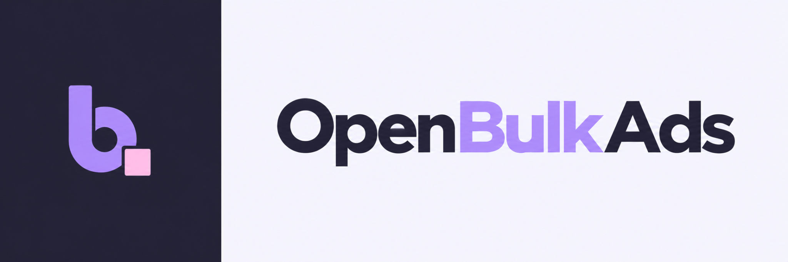

<p align="center">
  
</p>

<p align="center">
  <strong>Carga masiva de anuncios en Meta, en tu propia infraestructura.</strong>
</p>

<p align="center">
  <a href="LICENSE"></a>
  <a href=".github/workflows/ci.yml"></a>
  
</p>

---

## ¿Qué es OpenBulkAds?

OpenBulkAds es una herramienta **gratuita y de código abierto** para **crear muchos anuncios de Meta a la vez**, sin planillas ni trabajo repetitivo. Conectás tu cuenta de Meta y la herramienta arma los anuncios por vos — siempre **en pausa**, para que los revises antes de activar.

Lo que la hace distinta: **corre en tu propia infraestructura**. Tu token de Meta y tus archivos nunca salen de tus servidores. No hay un tercero en el medio.

> **Proyecto independiente.** OpenBulkAds no está afiliado ni respaldado por Meta. Lo usás bajo tu responsabilidad y respetando las políticas de Meta.

## ¿Para quién es?

Para gente de *paid media* —media buyers, agencias, freelancers— que:

- Sube muchos anuncios por día y está cansado de hacerlo uno por uno.
- Quiere tener el control de sus datos y no depender de un servicio externo.

No hace falta ser técnico para **usarlo**. Para **instalarlo** sí conviene una mano técnica (o tu equipo de IT); una vez montado, el día a día es simple. Ver la [parte técnica](#instalación-y-despliegue-parte-técnica).

## ¿Qué podés hacer?

- 📦 **Cargar anuncios en lote** — hasta 20 por vez, reutilizando un creativo o subiendo imágenes (JPG/PNG) y videos (MP4/MOV).
- 📋 **Copiar una campaña** con sus conjuntos (sin los anuncios), todo en pausa, revisando presupuesto y audiencia antes.
- 🆕 **Crear una campaña nueva desde un modelo** — tomás la configuración de un conjunto que ya funciona y armás una campaña desde cero.
- 🎬 **Subir videos pesados** (hasta 250 MB) desde tu compu o un link público de Google Drive.
- 💾 **Guardar presets** por cuenta: campaña, conjunto, identidad, textos y distribución, listos para reusar.
- 📜 **Historial completo** con los IDs y errores de Meta, para que nunca cargues algo dos veces por error.

## ¿Cómo funciona? (en 3 pasos)

1. **Conectás tu token de Meta** una vez (necesita permisos `ads_management` y `ads_read`).
2. **Elegís los archivos o links** y a qué campaña o conjunto van.
3. **OpenBulkAds crea los anuncios en pausa.** Vos los revisás y activás desde Ads Manager cuando quieras.

## Pensado para no romper nada

OpenBulkAds es deliberadamente cuidadoso con tu cuenta:

- **Nunca** activa, borra ni modifica anuncios que ya existen.
- Si una operación queda dudosa (se cortó internet, Meta respondió raro), **no la reintenta sola**: te avisa para que revises y evites duplicados.
- Respeta los límites que marca Meta y pausa cuando hace falta.

Creativos nuevos soportados hoy: **sitio web, WhatsApp e Instagram Direct**. Carruseles, formularios, catálogos y creativos dinámicos requieren adaptación.

---

## Instalación y despliegue (parte técnica)

OpenBulkAds ofrece dos modalidades de acceso según tu infraestructura:
1. **Red privada / VPN (Recomendado):** pensado para correr dentro de tu red privada (por ejemplo con [Tailscale](https://tailscale.com/)), manteniendo la app y tus datos completamente aislados de internet.
2. **Dominio con Reverse Proxy:** para desplegar en tu propio servidor o VPS detrás de Caddy, Nginx, Traefik o Cloudflare Tunnel.

---

### Requisitos

- Node.js >= 22.13
- PostgreSQL 16 (para desarrollo hay uno listo en Docker)
- Docker + Docker Compose (para el despliegue de referencia)
- Un token de usuario de Meta con permisos `ads_management` y `ads_read`

---

### Generación de claves de seguridad

Antes de arrancar, generá las dos claves necesarias para tu `.env`:

```bash
# Para TOKEN_ENCRYPTION_KEY (32 bytes en base64 para cifrar los tokens de Meta):
openssl rand -base64 32
# (o con Node: node -e "console.log(crypto.randomBytes(32).toString('base64'))")

# Para BETTER_AUTH_SECRET (secreto para sesiones de usuario):
openssl rand -hex 32
```

---

### Probarlo en tu compu (desarrollo)

1. **Instalar dependencias y configurar variables:**
   ```bash
   npm install
   cp .env.example .env
   ```
   Completá las variables generadas (`TOKEN_ENCRYPTION_KEY`, etc.) en tu `.env`.

2. **Iniciar la base de datos:**
   ```bash
   docker compose -f compose.dev.yaml up -d postgres
   ```
   > *Nota:* Si en Linux tu usuario no pertenece al grupo `docker`, anteponé `sudo`. Si ya tenés un PostgreSQL local corriendo en el puerto 5432, podés apuntar `DATABASE_URL` a tu base o cambiar el mapeo de puerto en `compose.dev.yaml`.

3. **Migrar las tablas y crear tu usuario administrador:**
   ```bash
   npm run db:migrate              # crea las tablas (carga .env automáticamente)
   npm run admin:create            # crea interactivamente tu usuario admin
   ```

4. **Iniciar el servidor de desarrollo:**
   - **Acceso local (misma máquina):**
     ```bash
     npm run dev                   # abre http://localhost:3000
     ```
   - **Acceso por red privada / Tailscale / LAN:**
     Si estás corriendo el devserver en un servidor, VM o homelab y entrás desde tu notebook por Tailscale o IP de red:
     ```bash
     npm run dev:network           # escucha en 0.0.0.0:3000
     ```
     En tu `.env`, asegurate de configurar `BETTER_AUTH_URL` con tu hostname (por ej. `http://mi-servidor.ts.net:3000`). OpenBulkAds deriva automáticamente los orígenes permitidos (`allowedDevOrigins`) desde allí para que Turbopack y las sesiones funcionen sin bloqueos.

---

### Ponerlo en producción

La guía completa —secretos, certificados, proxies externos, **backups**, actualizaciones y rollback— está en **[deploy/README.md](deploy/README.md)**.

#### Opción A: Red privada / VPN (Recomendado)
Un solo `docker compose` levanta la app + un proxy interno (Caddy con HTTPS automático y certificados privados) en la IP de tu VPN o Tailscale:

```bash
export VPN_BIND_ADDRESS=10.8.0.5                 # la IP de tu VPN o Tailscale
export MEDIA_HOST_DIR=/var/lib/openbulkads/media # carpeta para los archivos
docker compose -f compose.prod.yaml build
docker compose -f compose.prod.yaml up -d
```

#### Opción B: Dominio público con Reverse Proxy
Si publicás OpenBulkAds bajo un dominio (ej. `https://ads.mi-dominio.com`):
- Configurá `APP_DOMAIN=ads.mi-dominio.com` y `BETTER_AUTH_URL=https://ads.mi-dominio.com`.
- Si ubicás otro reverse proxy por delante (Nginx, Traefik, Caddy), asegurate de subir el límite de carga de archivos (ej. `client_max_body_size 260m;` en Nginx) para permitir la subida de videos pesados según `NEXT_PUBLIC_MEDIA_LIMIT_MB`.

---

### Configuración

Las variables están documentadas en [`.env.example`](.env.example). Las principales:

| Variable | Requerida | Para qué sirve |
| --- | --- | --- |
| `TOKEN_ENCRYPTION_KEY` | sí | Clave AES (exactamente 32 bytes en base64) para cifrar los tokens. Generar con `openssl rand -base64 32`. |
| `DATABASE_URL` | sí | Conexión a PostgreSQL de la app. |
| `MIGRATION_DATABASE_URL` | sí (prod) | Credenciales solo para migraciones; la app en marcha nunca migra. |
| `BETTER_AUTH_SECRET` | sí (prod) | Secreto aleatorio de 32+ caracteres para las sesiones. Generar con `openssl rand -hex 32`. |
| `BETTER_AUTH_URL` | sí (prod) | URL pública/interna de la app (p. ej. `http://servidor.ts.net:3000` o `https://ads.midominio.com`). |
| `ALLOWED_DEV_ORIGINS` | no | Hostnames adicionales permitidos en `next dev` (opcional; el host de `BETTER_AUTH_URL` se incluye automáticamente). |
| `MEDIA_ROOT` | sí | Carpeta privada donde se guardan los archivos, fuera del web root. |
| `NEXT_PUBLIC_MEDIA_LIMIT_MB` | no | Límite de tamaño por archivo en MB (default 250). Cambiarlo requiere reconstruir. |

### Verificación

```bash
npx tsc --noEmit        # tipos
npm run lint            # estilo
npm test                # pruebas
npm run test:db         # pruebas que usan PostgreSQL
npm run build           # build de producción
```

## Arquitectura

Next.js (runtime Node, *standalone*) + Better Auth (registro cerrado) + PostgreSQL/Drizzle + medios en disco local, detrás de un proxy interno en una VPN. Detalle completo en [docs/architecture/self-hosted.md](docs/architecture/self-hosted.md).

## Contribuir

Las contribuciones son bienvenidas. Leé [CONTRIBUTING.md](CONTRIBUTING.md) y el [Código de Conducta](CODE_OF_CONDUCT.md) antes de abrir un issue o PR.

## Seguridad

¿Encontraste una vulnerabilidad? No abras un issue público: seguí [SECURITY.md](SECURITY.md).

## Licencia

[MIT](LICENSE) © 2026 Matias Aguirre
